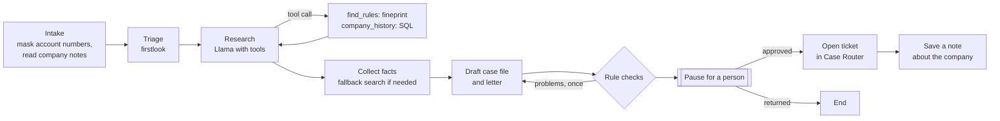

# caseworker

An AI agent that works a consumer financial complaint from intake to ticket. It sorts the complaint, looks up the rules that apply and the company's track record, drafts an acknowledgment letter, checks the draft against hard rules, **waits for a person to approve it**, and then opens a ticket in the right queue.

**[Results page](https://mjsampsonmusic.github.io/caseworker/)**: real held-out complaints worked end to end, with every tool call, draft letter and ticket, generated by GitHub Actions.

Built with LangGraph and LangChain (tool calling, checkpoints, memory, human-in-the-loop), Llama through Ollama, FastAPI, Streamlit and SQLite. It ties together three of my other projects: [firstlook](https://github.com/mjsampsonmusic/firstlook) for triage, [fineprint](https://github.com/mjsampsonmusic/fineprint) for the rules, and [Case Router](https://github.com/mjsampsonmusic/case-router) for tickets.

## Results

<!-- results:start -->
The first evaluation run on GitHub Actions writes this section from `results/results.json`. No number here is typed by hand.
<!-- results:end -->

## How it works



- **Tool calling.** The research step is a LangChain chat model with two tools bound to it: `find_rules` (fineprint's search over six CFPB regulations) and `company_history` (a SQL summary of the company's past complaints from the CFPB archive). LangGraph's `ToolNode` runs the calls, and the number of rounds is capped. If the model never searches the rules, a fallback search runs, and the evaluation counts how often that happens.
- **Checks the model cannot talk its way past.** Before a person sees a draft, code checks it: every cited section must be one the tools actually returned, the letter must carry the case number, it must not promise an outcome, and it must not contain anything that looks like an account number. A failing draft gets one repair round.
- **Human in the loop.** The graph stops at the review step with LangGraph's `interrupt`. The case is saved by the checkpointer, so a reviewer can approve it, edit the letter, or send it back, minutes or days later, and the graph resumes from that point.
- **Memory.** Each case has its own thread. After a ticket is filed, a short note about the case is saved in a LangGraph store under the company's name, and the next case for that company starts with those notes.
- **Tickets.** caseworker installs routing rules in Case Router once, then opens each approved ticket with a product tag in the subject, so Case Router puts it in the right queue and sets its deadline.

## Run it

You need Docker. This starts all four services plus Postgres and Ollama.

```bash
docker compose up -d --build
docker compose exec ollama ollama pull llama3.2:3b
docker compose exec fineprint python -m fineprint ingest
docker compose exec firstlook python -m firstlook data
docker compose exec firstlook python -m firstlook train
docker compose exec api python -m caseworker history --archives /firstlook-data/raw
```

Then open http://localhost:8503, or use the API:

```bash
curl -s localhost:8000/cases -H 'Content-Type: application/json' -d '{
  "company": "Example Collections",
  "complaint": "A debt collector calls me at 6 a.m. every day about a debt I do not owe and never sent a validation notice."}'
# -> {"case_id": "CW-...", "status": "awaiting review", "draft": {...}, "checks": {...}, "trace": [...]}

curl -s localhost:8000/cases/CW-.../review -H 'Content-Type: application/json' -d '{"approved": true, "reviewer": "me"}'
# -> {"status": "filed", "ticket": {"queue": "Debt Collection", "respond_by": "..."}}
```

| Endpoint | What it does |
|---|---|
| `POST /cases` | Work a complaint up to the review step |
| `GET /cases/{id}` | The case: triage, rules, history, tool use, draft, checks, trace, tokens |
| `POST /cases/{id}/review` | Approve (optionally with an edited letter) or return the case |

## Evaluation

The [evaluate workflow](.github/workflows/evaluate.yml) builds everything on a CPU-only GitHub runner: fineprint's rule index, firstlook's model and data, Case Router, and Llama in Ollama. It then works 30 complaints from firstlook's held-out test set (3 per product), approves every draft, and scores what can be checked without a person:

- triage against the bureau's product label
- whether a cited rule comes from a regulation that governs that product (for example, debt collection complaints should cite Regulation F)
- drafts passing the checks on the first try and after one repair
- whether the model searched the rules itself, repeated tool calls, and fallback searches
- whether Case Router put each ticket in the expected queue
- whether later cases for a company saw notes from earlier ones
- tokens and seconds per case

```bash
python -m caseworker history --archives path/to/firstlook/data/raw
python -m caseworker evaluate --cases path/to/firstlook/data/splits/test.csv
python -m caseworker site
```

## Develop

```bash
python -m venv .venv && . .venv/bin/activate
pip install -r requirements-dev.txt
python -m pytest
```

The tests replay scripted model replies, including tool calls, so they run in seconds without Ollama. One test runs the real Case Router app in-process to check that tickets land in the right queue.

## Project layout

```
src/caseworker/
  agent.py      the LangGraph graph: tools, checks, review, ticket, memory
  services.py   clients for firstlook, fineprint and Case Router; the SQLite history
  evaluate.py   the end-to-end evaluation
  site.py       the results page
  api.py        FastAPI app
app/streamlit_app.py
tests/
```

## Limits

- Letters are drafts for a caseworker, not legal advice, and a person approves every one.
- "The cited rule fits the product" is a coarse automatic check; it cannot judge whether the letter applies the rule well.
- A 3B model on a CPU is slow and sometimes skips its tools; the fallback search and the evaluation make that visible instead of hiding it.
- Built with Claude as a coding assistant. The tests and the evaluation check what the code does.
